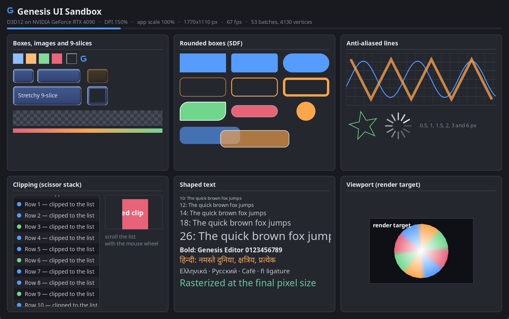
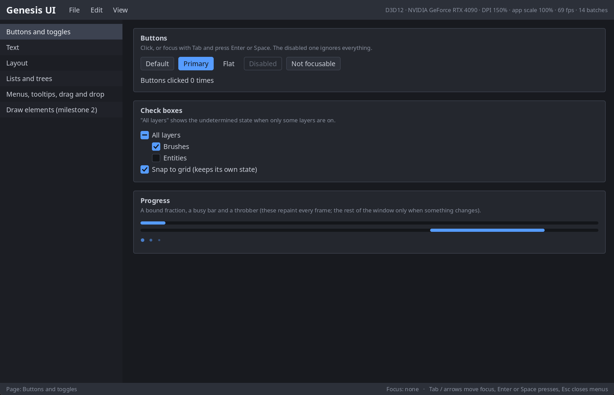
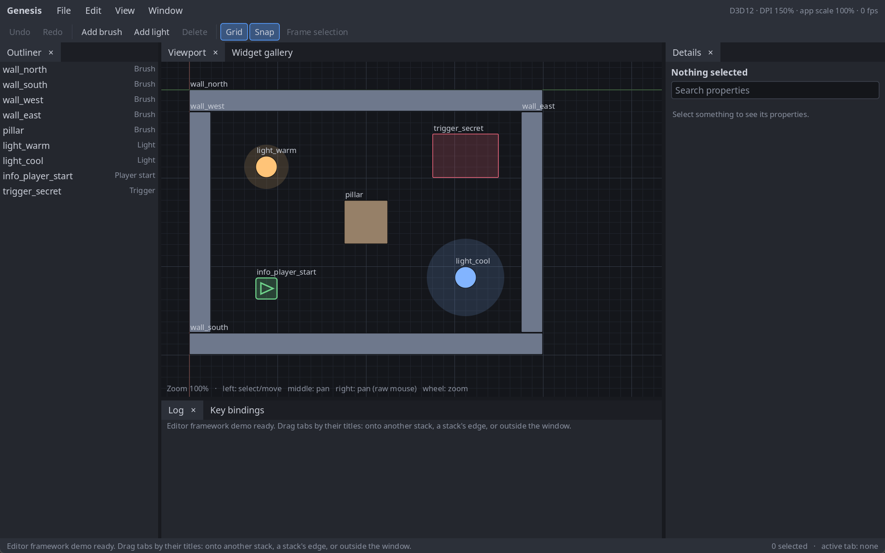
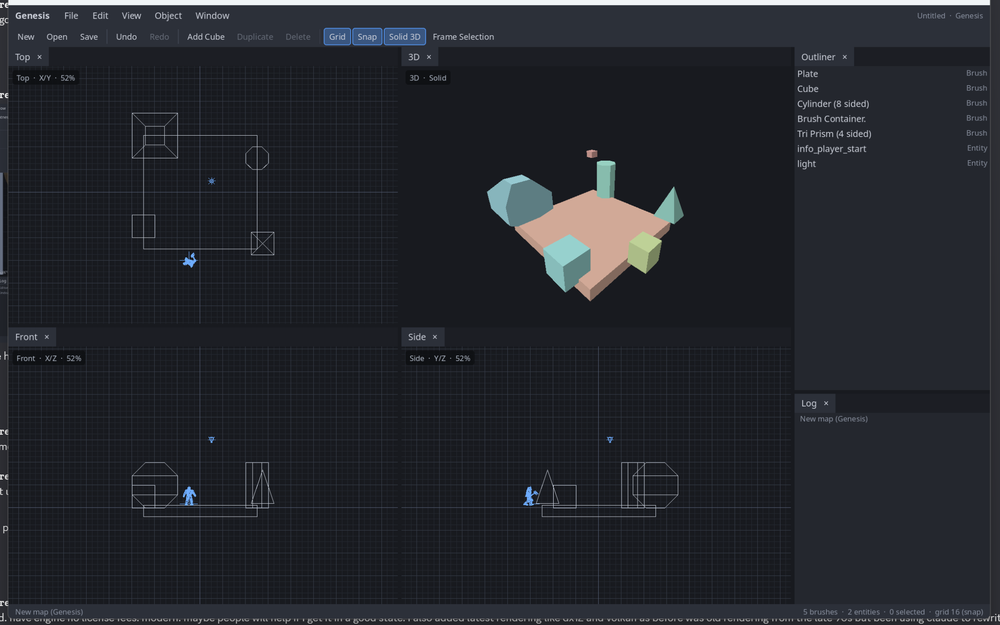

# Genesis UI — Design

Status: **approved direction** (decisions recorded in §16). Milestone 1
(the map core freed from MFC, §14.4), milestone 2 (platform layer, RHI,
UI renderer, fonts, §17), milestone 3 (widget core and input, §18),
milestone 4 (editor framework, §19) and milestone 5 (the new map editor
shell, §20) are implemented.

Genesis UI is the user-interface framework for Genesis Editor and, later,
Genesis Engine games. It replaces MFC in the editor, provides in-game UI, and
is the foundation for a data-driven widget layer (in the spirit of Unreal's
UMG) and a visual scripting system (in the spirit of Blueprints).

This document covers the architecture, the order in which pieces get built,
and how the existing MFC editor moves onto it.

## Contents

1. [Goals and non-goals](#1-goals-and-non-goals)
2. [Ground rules](#2-ground-rules)
3. [Layers](#3-layers)
4. [Platform layer](#4-platform-layer)
5. [Rendering](#5-rendering)
6. [Widget core](#6-widget-core)
7. [Input, focus and the application loop](#7-input-focus-and-the-application-loop)
8. [Styling and text](#8-styling-and-text)
9. [Editor framework](#9-editor-framework)
10. [Object model and reflection](#10-object-model-and-reflection)
11. [Widget assets (the UMG-like layer)](#11-widget-assets-the-umg-like-layer)
12. [In-game UI](#12-in-game-ui)
13. [Visual scripting outlook](#13-visual-scripting-outlook)
14. [Moving the editor off MFC](#14-moving-the-editor-off-mfc)
15. [Milestones](#15-milestones)
16. [Decisions](#16-decisions)
17. [Milestone 2 notes](#17-milestone-2-notes)
18. [Milestone 3 notes](#18-milestone-3-notes)
19. [Milestone 4 notes](#19-milestone-4-notes)
20. [Milestone 5 notes](#20-milestone-5-notes)

---

## 1. Goals and non-goals

**Goals**

- One retained-mode UI framework for both the editor and games.
- GPU-rendered through the same D3D12/Vulkan code the map views use, with
  per-monitor DPI awareness from day one.
- Declarative C++ construction of widget trees that reads like the layout it
  produces.
- Editor-grade features: docking tabs, menus/toolbars driven by commands,
  virtualized lists and trees, a property grid, text editing with IME.
- Game-grade features: gamepad/keyboard navigation, multiple local users,
  resolution scaling, rendering UI into textures for world-space panels.
- A clean seam for a data-driven layer (widget assets, designer, bindings,
  animation) and visual scripting, without the core depending on either.
- Windows first, with every OS dependency behind an interface.

**Non-goals (for now)**

- Matching Unreal's APIs. We take architecture ideas, not interfaces.
- Mobile/touch-first design, accessibility APIs, right-to-left text. The
  design leaves room for them; they are not in the first milestones.
- A general-purpose app framework. Genesis UI serves the editor and games.

## 2. Ground rules

**Licensing.** Genesis Editor is GPL (it derives from Qoole 99). The Unreal
source at `G:\GitHub\dazzlesoftware\UnrealEngine` is under the Unreal Engine
EULA, which does not allow copying its code into this project, and is not
GPL-compatible. It may be **read for architecture**: concepts, data flow,
names of ideas. No code, no code structure transcribed line by line, no
shader or data files. Third-party libraries must be GPL-compatible
(MIT/BSD/zlib/Apache-2.0/FTL are fine).

**Language and libraries.** C++20 (MSVC v145), x64 only. Standard library containers
and smart pointers underneath, exposed through Unreal-style aliases so the
code reads consistently:

| Alias | Underlying |
|---|---|
| `TArray<T>` | `std::vector<T>` |
| `TMap<K,V>` | `std::unordered_map<K,V>` |
| `TSharedPtr<T>` / `TSharedRef<T>` / `TWeakPtr<T>` | `std::shared_ptr` / non-null wrapper / `std::weak_ptr` |
| `FString` | `std::u8string`-backed UTF-8 string |
| `FName` | interned string id (hash + table) |

Aliases keep the door open to custom implementations later (allocators,
`TSharedRef` debug checks) without touching call sites.

**Naming.** Unreal-style prefixes by type, as agreed for the rename:
`S` widgets, `F` plain structs/classes, `T` templates, `E` enums, `I`
interfaces, `U` reflected objects (from milestone 7), `G` globals.

**Source layout.** New code lives in modules under `source/Engine/`, each a
static library project with a `Public/` and `Private/` folder:

```
source/Engine/
  Core/            strings, names, math, delegates, logging, asserts,
                   file I/O, service interfaces (config, dialogs, progress)
  MapCore/         Basic, Objects, Render and Game built as one MFC-free
                   library (milestone 1; the sources stay in their folders)
  Tests/           GenesisTests: doctest tests of Core and MapCore
  ApplicationCore/ platform interfaces + Win32 implementation
  RHI/             thin GPU abstraction (D3D12 first, Vulkan second)
  UICore/          widget base, layout, paint, draw elements, styles, fonts
  UI/              widgets, application loop, input routing, commands,
                   menus, docking
  UIRenderer/      draw elements -> batches -> RHI
  Object/          reflection and object model            (milestone 7)
  UMG/             data-driven widget layer               (milestone 8)
```

The existing editor code (`Basic`, `Objects`, `Render`, `Game`, `Editor`,
`Interface*`) stays where it is until it is ported or retired. `MapCore`
compiles `Basic`, `Objects`, `Render` and `Game` in place.

## 3. Layers

```
 ┌─────────────────────────────────────────────────────────────┐
 │ Visual scripting (graphs, compiler, VM)          milestone 10│
 ├─────────────────────────────────────────────────────────────┤
 │ Widget designer (editor tool)                     milestone 9│
 ├─────────────────────────────────────────────────────────────┤
 │ UMG: widget assets, slots-as-objects, bindings,              │
 │      animation, game viewport integration         milestone 8│
 ├──────────────────────────────┬──────────────────────────────┤
 │ Object: reflection, types,   │ UI: widgets, app loop, input, │
 │ properties, functions,       │ commands, menus, docking      │
 │ serialization  milestone 7   ├──────────────────────────────┤
 │                              │ UICore: SWidget, layout,      │
 │                              │ paint, styles, fonts, text    │
 ├──────────────────────────────┴──────────────────────────────┤
 │ UIRenderer  ──►  RHI (D3D12, Vulkan)                         │
 ├─────────────────────────────────────────────────────────────┤
 │ ApplicationCore (platform interfaces; Win32)  ─  Core        │
 └─────────────────────────────────────────────────────────────┘
```

Rules:

- **UICore/UI never depend on Object.** The core framework is plain C++.
  Reflection is layered on top (UMG wraps core widgets), the same split
  Unreal has between Slate and UMG.
- **Widgets never touch the GPU.** They emit draw elements; the renderer
  turns them into GPU work.
- **Widgets never touch the OS.** They receive events from the application,
  which receives them from the platform layer.

## 4. Platform layer

Module `ApplicationCore`. Four interfaces, mirroring the split that keeps
Slate portable:

| Interface | Role |
|---|---|
| `IPlatformApplication` | Pump OS messages, create windows, cursor, clipboard, display metrics, gamepad polling, text input (IME) system. |
| `IPlatformWindow` | One native window: show/hide, move/resize, title, native handle, DPI scale, opacity, set-as-modal. Created from a plain `FWindowDesc` struct. |
| `IPlatformMessageHandler` | Callbacks the application receives: key down/up/char, mouse buttons/move/wheel, raw mouse, gamepad buttons/axes, window resized/moved/activated/closed, OS paint, files dropped. Each returns whether it was handled. |
| `ICursor` | Cursor shape, position, clipping, visibility. |

The UI application implements `IPlatformMessageHandler` and is the only
bridge from the OS into widgets.

**Win32 implementation**

- Per-monitor DPI awareness v2 via the application manifest;
  `WM_DPICHANGED` reaches widgets as a scale change on that window.
- Input messages are queued during `PumpMessages` and replayed in a
  `ProcessDeferredEvents` step at a well-defined point of the frame.
  Resize/move/paint are handled immediately (Windows needs that during
  modal size loops).
- Gamepads via XInput first (GameInput later). Raw mouse via
  `WM_INPUT` for viewport fly-through.
- IME through IMM32 first (composition string, candidate window position);
  TSF can come later behind the same `ITextInputMethodSystem` interface.
- Windows can be OS-decorated or borderless with a UI-drawn title bar
  (needed for a modern-looking editor and for floating dock windows).

A headless `FNullPlatformApplication` (no windows, scripted input) is part
of the first milestone. It is what layout and input tests run on.

## 5. Rendering

### 5.1 Draw elements

Widgets paint into an `FDrawElementList` for their window. Element kinds:

| Element | Use |
|---|---|
| `Box` | Image or 9-slice brush (borders, panels, buttons), with tiling and tint. |
| `RoundedBox` | Rounded rectangle with outline, drawn by an SDF shader (no geometry per corner). |
| `Text` | A shaped glyph run (output of the text system), one quad per glyph from a font atlas. |
| `Lines` | Anti-aliased polyline (graph wires, gizmos, grids). |
| `Spline` | Cubic Bézier, tessellated (visual scripting wires). |
| `CustomVerts` | Caller-provided triangles with a texture. |
| `Viewport` | A render-target texture produced elsewhere (the 3D map views, previews, video). |

Every element carries a **layer id** and a **clip state**. `OnPaint`
returns the highest layer it used; layers give draw order, submission order
breaks ties within a layer.

**Clipping** is axis-aligned scissor rectangles only. Rotated content that
needs clipping renders to a texture first (§12). This avoids Slate's
stencil path entirely.

### 5.2 Batching

`UIRenderer` turns element lists into batches:

1. Tessellate elements into one vertex format
   (`position, uv, color, secondary color/params`).
2. Assign each to a batch key `(layer, shader, texture, clip state)`.
3. Stable-sort by layer; merge adjacent compatible batches into one
   vertex/index range.

The output is a short list of `(pipeline, texture, scissor, index range)`
the RHI backend draws. Backends stay thin; all UI logic is renderer-agnostic.

### 5.3 RHI

The D3D12 and Vulkan renderer plugins (`GenesisDrawDX12`/`GenesisDrawVulkan`)
each built their own device. Genesis UI needs the same GPU for UI and for
the 3D map views, so the device code moves into a small shared `RHI`
module:

- device + queue, one **swapchain per platform window**,
- buffers (upload/default), 2D textures, render targets,
- pipelines from precompiled shaders (HLSL → DXIL/SPIR-V, as today),
- a command list with scissor/viewport/draw-indexed.

This is deliberately much smaller than a full engine RHI. It grows when the
engine renderer arrives. The map views become `Viewport` elements: they
render into an RHI render target and the UI composites it.

### 5.4 Textures and fonts

- **Atlases**: small UI images (icons, brush pieces) are packed into atlas
  pages at load time; large images get their own texture.
- **Fonts**: FreeType for rasterization, HarfBuzz for shaping (both
  vendored, GPL-compatible). Glyphs rasterize on demand at the final pixel
  size (font size × DPI scale) into alpha atlas pages, so text stays crisp at
  every DPI. MSDF and color-emoji pages are later additions.
- Text is measured and shaped by `UICore`; the renderer only sees glyph
  quads.

## 6. Widget core

Module `UICore` (base classes, layout, paint) and `UI` (concrete widgets).

### 6.1 SWidget

Every widget derives from `SWidget`. Subclasses implement:

| Method | Pass |
|---|---|
| `FVector2 ComputeDesiredSize(float LayoutScale)` | Measure, bottom-up. |
| `void ArrangeChildren(const FGeometry&, FArrangedChildren&)` | Arrange, top-down. |
| `int32 OnPaint(const FPaintArgs&, const FGeometry&, const FRect& Culling, FDrawElementList&, int32 Layer, const FWidgetStyle&)` | Paint. |
| `FChildren& GetChildren()` | Tree access. |

plus optional input handlers (§7). Shared state on the base: visibility,
enabled, clipping mode, render transform, tooltip, cursor, tag, cached
desired size, cached geometry, dirty flags.

Three kinds of widget:

- **Leaf** — no children (`STextBlock`, `SImage`).
- **Compound** — one child slot, built in `Construct` (`SButton`,
  `SBorder`, most user-made widgets).
- **Panel** — many typed slots (`SHorizontalBox`, `SOverlay`, `SGridPanel`).

### 6.2 Slots

A slot holds one child plus the layout data that belongs to the *parent–child
relationship*, not to the child: padding, horizontal/vertical alignment, and
panel-specific rules (auto vs fill sizing and fill weight in boxes,
row/column/span in grids, anchors/offsets/z-order in a canvas). Slot setters
invalidate the owning panel's layout.

### 6.3 Attributes and invalidation

`TAttribute<T>` holds **either a value or a binding** (a function returning
`T`). Unlike Slate's two systems, there is one:

- A widget declares its attributes with the invalidation they cause
  (`Layout`, `Paint`, `ChildOrder`, `Visibility`, `RenderTransform`).
- Setting a value invalidates immediately if it changed.
- Bound attributes are evaluated once per frame before layout; a changed
  result invalidates with the declared reason. Unchanged bindings cost one
  call and a compare.

### 6.4 Layout and paint are retained

Slate re-arranges during paint and again during hit-testing. Genesis UI
stores the result instead:

1. **Measure** walks only subtrees with `Layout` dirty and caches desired
   sizes.
2. **Arrange** walks dirty subtrees top-down and stores each widget's
   `FGeometry` (local size + accumulated layout transform; render transform
   kept separately).
3. **Paint** reuses each widget's cached element sub-list unless it is
   `Paint`-dirty or flagged **volatile** (animated, video, viewport).
4. **Hit-testing** walks stored geometry.

One mechanism (dirty flags + cached element ranges per widget) replaces
Slate's invalidation roots, proxy lists and global-invalidation mode. An
idle editor redraws nothing.

`FGeometry` keeps **layout in logical units**; DPI and application scale are
transforms pushed from the window down. Text is the only thing that cares
about final pixel size (for glyph rasterization).

### 6.5 Declarative construction

Large UIs are written in C++, so construction has to read like the layout.
We keep the familiar shape — an arguments struct with chained setters, slots
added with `+`, content in `[ ]` — implemented with C++20 templates and a
handful of small macros (our own):

```cpp
SNew(SVerticalBox)
+ SVerticalBox::Slot().AutoHeight().Padding(4)
[
    SNew(STextBlock).Text("Textures")
]
+ SVerticalBox::Slot().FillHeight(1.0f)
[
    SAssignNew(TextureList, SListView<FTextureItemPtr>)
        .ItemsSource(&Textures)
        .OnGenerateRow(this, &STextureBrowser::MakeRow)
]
```

- `SNew(T)` creates the widget, applies the arguments, calls
  `T::Construct(const FArguments&)`, returns `TSharedRef<T>`.
- Argument kinds: attribute (value or binding), plain value, style
  reference, event (delegate), default slot, named slot, slot list.
- `SAssignNew(Var, T)` also stores the widget in `Var`.

### 6.6 Built-in widgets (first set)

| Group | Widgets |
|---|---|
| Layout | `SBox` (size overrides), `SBorder`, `SHorizontalBox`, `SVerticalBox`, `SOverlay`, `SGridPanel`, `SWrapBox`, `SCanvas` (anchors), `SScaleBox`, `SScrollBox`, `SSplitter`, `SWidgetSwitcher` |
| Display | `STextBlock`, `SRichTextBlock` (later), `SImage`, `SSeparator`, `SProgressBar`, `SThrobber` |
| Input | `SButton`, `SCheckBox`, `SEditableText`, `SEditableTextBox`, `SMultiLineEditableText`, `SSpinBox<T>`, `SNumericEntryBox<T>`, `SSlider`, `SComboBox<T>`, `SColorPicker`, `SMenuAnchor` |
| Views | `SListView<T>`, `STreeView<T>`, `STileView<T>` (virtualized: item source + row generator), `SHeaderRow` for columns |
| Windows | `SWindow` (root of a tree, owns an `IPlatformWindow` or is virtual), `SToolTip`, `SViewport` |

## 7. Input, focus and the application loop

Module `UI`, class `FUIApplication`.

### 7.1 Frame

```
PumpMessages → ProcessDeferredEvents (input → events)
            → Tick timers and widgets that asked for it
            → Evaluate bound attributes
            → Measure / Arrange dirty subtrees
            → Paint dirty windows → UIRenderer → RHI → Present
            → Sleep if nothing is dirty, animating or capturing
```

Modal windows run a nested loop over the same frame function.

### 7.2 Routing

- The widget under a pointer is found from stored geometry, giving a
  **widget path** (root → leaf).
- Pointer events: a *preview* pass tunnels root → leaf, then the normal
  pass bubbles leaf → root. A widget holding pointer capture receives
  events directly.
- Key events route along the **focus path**, not the pointer path, with the
  same preview/bubble order.
- `OnMouseEnter`/`OnMouseLeave` come from diffing the previous and current
  pointer paths.

### 7.3 Replies

Handlers return an `FReply`: handled or not, plus **requests** — capture or
release the pointer, set or clear focus, detect a drag, begin a
drag-and-drop, lock the cursor, keep the frame loop awake. Widgets never
change application state directly; the application applies the requests
after routing. This keeps routing deterministic and testable on the
headless platform.

### 7.4 Users, focus and navigation

- `FUIUser` holds per-user state: focus path, pointer capture, cursor, hover
  path, drag operation, tooltip. Input devices map to users, so split-screen
  players each get their own focus. The editor uses user 0.
- Widgets opt into focus. Focus changes deliver focus-lost/focus-received
  with a cause (mouse, navigation, programmatic).
- **Navigation**: an unhandled key or stick input is mapped by a replaceable
  `FNavigationConfig` to Up/Down/Left/Right/Next/Previous/Accept/Back.
  Widgets on the focus path may answer with stop, wrap, explicit target, or
  custom; otherwise the application searches stored geometry for the nearest
  focusable widget in that direction.

### 7.5 Also in the application

- Mouse capture, cursor queries (widget asks for a cursor shape),
  drag detection threshold and `FDragDropOperation` payloads with
  enter/over/leave/drop on targets.
- Tooltips after a hover delay, in a reusable tooltip window.
- A **menu stack**: popups open as child windows or in-window layers;
  clicking outside dismisses down to the clicked menu.
- **Input pre-processors** that see input before widgets (global hotkeys,
  game input sharing the window with UI, a gamepad-driven cursor).

## 8. Styling and text

**Styles.** `FStyleSet` is a named dictionary of brushes, colors, fonts,
margins and per-widget style structs (`FButtonStyle`: normal/hovered/
pressed/disabled brushes, padding, text style…). Sets register by name in a
global registry; widgets take a style argument and fall back to the active
application style by name. Colors go through a semantic palette
(`Panel`, `Foreground`, `Highlight`, `Error`…) so themes swap palettes, not
widgets. Styles are built in code first; loading from data files comes
with the object model.

**Text.**

- `FTextLayout`: text → lines → runs; word wrapping; shaping per run via
  HarfBuzz; hit-testing (point → character, character → rect); highlight
  ranges for selection.
- `STextBlock` uses a cached layout with a fast path for single-line text.
- `FEditableTextLayout` adds caret, selection, undo, clipboard, scrolling and
  an IME context (composition range, candidate window placement) used by
  `SEditableText` and `SMultiLineEditableText`.
- Rich text (markup with inline images/widgets) is a later addition.

## 9. Editor framework

Built on the core; all of it is needed before the editor can leave MFC.

**Commands.** `FUICommandInfo` defines a command once: id, label, tooltip,
icon, kind (button, toggle, radio) and default key chords. Command sets are
grouped by context (`LevelEditor`, `TextureBrowser`…). `FUICommandList`
maps commands to actions (execute, can-execute, is-checked, is-visible).
Menus, toolbars and keyboard shortcuts all read the same command, so a
disabled command greys out everywhere. User key rebinding is stored per
context. This replaces MFC's `ON_COMMAND`/`ON_UPDATE_COMMAND_UI` maps and the
`IDR_MAINFRAME` accelerator table.

**Menus and toolbars.** A **named menu registry**
(`"MainMenu.File"`, `"MapView.Context"`): menus are lists of sections and
entries, built lazily when opened, extendable by name from anywhere
(including plug-ins and, later, scripts). Toolbars use the same registry.
This replaces the four `.rc` menus and ten bitmap toolbars.

**Docking.** `FTabManager` with tab spawners (id → function creating the tab
content), tab roles (document vs panel), and a layout tree of areas,
splitters (orientation + size ratios) and tab stacks. Layouts save to and
restore from JSON per user, with a version number that falls back to the
default layout when it changes. Tabs drag out into floating windows and dock
back via drop targets on each area. This replaces the MRC docking library
in `Interface2`.

**Property grid.** A details view that builds rows from a property
description of the selected object(s): categories, name/value columns,
per-type editors (numbers, text, colors, enums, vectors, asset pickers),
multi-selection with "multiple values", undo. Until the object model exists
(§10), the editor supplies descriptions by hand through an
`IPropertySource` interface; later the reflection system generates them.
This replaces the MFC property sheets and `FPropertyList`.

**Viewport widget.** `SViewport` hosts an `IViewportClient` that renders into
an RHI render target and receives the widget's input (mouse, keys, focus,
cursor queries, raw mouse when captured). The four map views become
viewport clients, so they are dockable tabs like any other panel.

## 10. Object model and reflection

Needed by the widget-asset layer, the designer's details panel, data-driven
styles, save/load of assets, and visual scripting. Not needed by the core.

Minimum feature set:

- **Type registry**: name → type info for primitives, enums, structs and
  classes, with inheritance and a factory.
- **Properties**: name, type, accessor (offset or getter/setter), flags
  (editable, saved, bindable, transient) and string metadata (category,
  display name, min/max, tooltip).
- **Functions**: name, parameter/return descriptors, generic invoke, flags
  (callable, pure, event, overridable).
- **Events/delegates** bindable by object + function name.
- **Change notification** per property (for bindings and undo).
- **Object identity and ownership**: stable ids, outer/sub-object
  ownership, reference counting with weak references (no tracing GC
  initially).
- **Serialization**: generic read/write of properties, delta against
  defaults, versioned.
- **Runtime-defined classes**: a class that extends a native class with
  extra properties/functions. Visual scripting needs this; the API is
  designed for it from the start even if it ships later.

Registration is done with **C++ macros and templates at static-init time**
(no separate header-parsing tool). A code generator can replace the
boilerplate later if it becomes a burden.

## 11. Widget assets (the UMG-like layer)

Module `UMG`. Reflected `UWidget` objects wrap core widgets:

- `UWidget::RebuildWidget()` creates the core `SWidget`;
  `SynchronizeProperties()` pushes property values to it;
  `ReleaseUIResources()` drops it while the object lives on.
- `UPanelWidget` holds `UPanelSlot` objects; each panel type has its own slot
  class carrying layout properties (as in §6.2, but as reflected objects).
- `UUserWidget` owns a `UWidgetTree`; widgets flagged *is variable* become
  named members the owning code or script can reach.
- **Asset format** (JSON first, binary later): schema version, parent class,
  list of widget nodes (stable id, type, property overrides, is-variable,
  slot record), parent→children order, bindings, animations.
- **Bindings** are push-based from the start: view-model objects announce
  property changes (§10), compiled bindings copy values on change, with
  optional converters and one-way/two-way/one-time modes. No per-frame
  polling.
- **Animation**: per-widget property-path tracks with keyed curves
  (opacity, colors, render transform, slot padding), evaluated each tick.
- **Design-time flag**: widgets know when they are being previewed in the
  designer; runtime-only code and bindings are skipped there.

The **designer** (milestone 9) is an editor tab containing a preview
instance on a zoom/pan surface, a hierarchy tree with drag-to-reparent, a
palette of widget templates with drag-to-create, the reflection-driven
details panel for the selected widget and its slot, and undo via snapshots
of the serialized tree.

## 12. In-game UI

- **Game viewport**: per-player layers inside the game viewport widget; a
  widget is added to the whole viewport or to one player's region.
- **Input modes**: UI only, game and UI, game only — controlling cursor
  visibility and lock, and whether focus sits on the game or on widgets.
- **Multiple users and gamepads**: §7.4.
- **Resolution scaling**: UI is authored at a reference resolution; a
  configurable curve maps the viewport's short side (or width) to a scale
  factor applied at the window root.
- **Render to texture**: a virtual window (no OS window) renders a widget
  tree into an RHI render target. Used for world-space panels (a quad in the
  scene; pointer input arrives by ray-casting into the panel), cached
  rarely-changing panels, and rotated content that needs clipping.

## 13. Visual scripting outlook

Planned after the widget layer; recorded here so earlier layers don't block
it.

- **Graph data** (editor-only): graphs of nodes with typed pins and links,
  plus a schema that defines valid connections and the context menu of
  available nodes.
- **Compiler**: graph → reflected class (properties, functions) with a
  bytecode body per function, run by a small VM. The graph never ships; the
  compiled class does.
- **Graph editor**: a zoom/pan canvas, node widgets, pin widgets and wire
  drawing (`Spline` elements) — built entirely from Genesis UI.
- Widget assets get event graphs (On Clicked, On Construct…) through the
  same mechanism.

## 14. Moving the editor off MFC

### 14.1 What exists today

| MFC surface | Count / classes | Replacement |
|---|---|---|
| Main frame, MDI, child frames | `FMainFrame`, `FVFrame`, `FDocTemplate` | `SWindow` + `FTabManager` layout |
| Map views (2D/3D) | `FMapView` (CView) + `GenesisDraw*` plugins | `SViewport` + viewport clients on the RHI |
| Docking panels | MRC library (`Interface2`, ~10k lines), `FWorkSpaceBar`, `FOutputBar` | Docking framework (§9) |
| Toolbars | 10 bitmap toolbars, `CToolBarEx` | Command-driven toolbars |
| Menus | 4 menus + accelerators in `.rc` | Menu registry + commands |
| Tree views | `FTreeView`, `FPrefabMgr` | `STreeView` |
| Property sheets/pages | `FPropSheet` + 7 pages, `FPropertyList`, in-place editors | Property grid |
| Texture browser | `FTexView`, `FTexWnd`, `FTexDraw`, `FTexMgr`, `FTexRep` | `STileView` + texture thumbnails |
| Prefab browser | `FPrefabFrame`, `FPrefabView` | Panel with `SViewport` preview |
| Config dialogs | `FConfigSheet` + 5 pages | Settings tab built on the property grid |
| Other dialogs | Compile, entity select, hollow prompt, colors, about | Modal `SWindow`s |
| Output/process log | `FProcessWnd` (rich edit) | Log panel (`SListView` of lines) |

### 14.2 What must be untangled first (done in milestone 1)

The non-UI code is lightly coupled to MFC and can be freed early, behind
small services in `Core`/`ApplicationCore`:

| Used today | Where | Replacement |
|---|---|---|
| `ASSERT`, `TRACE` | everywhere | `check`, `GLog` |
| `CString`, `CArray`, `CFile` | `Basic`, `Objects`, `Editor` | `FString`, `TArray`, `FFile` |
| `AfxGetApp()->Get/WriteProfile*` | `LConfig` | Config service (INI/JSON in the user profile) |
| `MessageBox`, `AfxGetMainWnd` | `Basic`, `Game`, `Objects` | `IMessageDialog` service |
| `CProgressWnd` | `Objects`, `Game` | `IProgress` service |
| `CDirDialog` | `Game` | `IFileDialogs` service |
| `CDocument` / `CObject` | `FEditorDoc`, `FDocView` | Plain `FMapDocument` model + undo stack; MFC adapter while both UIs exist |

### 14.3 Strategy

**A new editor shell, not an MFC hybrid.** Embedding Genesis UI panels
inside the MFC frame would mean two message loops, two focus systems and two
docking systems fighting each other. Instead:

1. Free the core (14.2) so the map model, geometry, games and renderer build
   without MFC.
2. Build a new `GenesisEditor` shell on Genesis UI: main window, docking,
   menus/toolbars from commands, and the four map views as viewport tabs —
   enough to open, view, select and save a map.
3. Port panels in order of use: tree view → property grid pages → texture
   browser → prefab browser → dialogs and settings.
4. Keep the MFC editor building as `GenesisEditorLegacy` until the new shell
   reaches parity, then delete MFC, `Interface`, `Interface2` and the MFC
   renderer plugin.

### 14.4 Milestone 1 result

`source/Engine/MapCore` builds `Basic`, `Objects`, `Render` and `Game` as
one static library. It is called MapCore because it is the map model,
geometry/CSG, view math and game definitions: the core of map editing that
both the MFC editor and the new shell build on, kept distinct from the
generic `Core` module. Its precompiled header (`MapCorePCH.h`) includes only
the C runtime and `Core`; nothing on its include path leads to MFC, Windows
or the editor UI.

- `ASSERT`/`TRACE` became `check`/`LTrace` (the `LogMapCore` category);
  `CString`/`CArray`/`CFile` became `FString`/`TArray`/`FFile` where the map
  core used them.
- User interaction goes through `FServices` (`Core/Public/Services`):
  `IConfigStore` (used by `LConfig`), `IMessageDialog` (`LError`, `LFatal`,
  `LAskYesNo`), `IProgress` and `IFileDialogs` (`LBrowseForFolder`). Each has
  a default that needs no UI.
- `Editor/MfcServices.cpp` registers the MFC implementations at startup:
  the `CWinApp` registry profile (existing settings load unchanged),
  `MessageBox`, `CProgressWnd`, `CDirDialog`, and an output device feeding
  the output pane.
- The renderer interface is split: `FDraw` (`Render/DrawBase.h`) is
  window-free and is what `View` draws through; `FWndDraw`
  (`Interface/Draw.h`) adds the MFC window and `Paint()` for the
  `GenesisDraw*` plugins.
- Milestones 1 and 2 each started a `Core` module; they were merged into one
  (milestone 2's strings, containers, logging and math plus milestone 1's
  services, `FFile`, `FApp` and ANSI conversions). `check` reports and lets
  the developer continue in debug builds (the behaviour of the MFC `ASSERT`
  it replaces in the map core); `checkNoEntry` is fatal.

Still coupled to MFC: `Editor` (`FEditorApp`, `FEditorDoc` as a
`CDocument`, the undo operations) and `Interface`/`Interface2` (all
windows, dialogs, the renderer plugins and the MRC docking library), as
planned for milestones 5 and 6. The map core's strings are still in the
ANSI code page (the projects build with the multibyte character set);
conversion to UTF-8 happens at the service boundary.

## 15. Milestones

Each milestone ends with something runnable and its own PR(s).

| # | Milestone | Exit criteria |
|---|---|---|
| 0 | **x64**, drop MGL/Glide | Done: x64-only build, MGL/Glide removed. |
| 1 | **Core free of MFC** | Done (§14.4): `Basic`/`Objects`/`Render`/`Game` build as the `MapCore` static library without MFC headers; the MFC editor works through adapters; `GenesisTests` pass. |
| 2 | **Platform + RHI + UI renderer + fonts** | Done (§17): `UISandbox` app: a DPI-aware window drawing boxes, rounded boxes, lines and shaped text through D3D12 and Vulkan; resizes and moves across monitors cleanly. |
| 3 | **Widget core + input** | Done (§18): layout panels, text block, button, checkbox, text box, scroll box, splitter, list/tree view; focus, keyboard navigation, capture, drag-drop, tooltips, menu popups. Widget gallery in `UISandbox`; headless layout/input tests pass. |
| 4 | **Editor framework** | Done (§19): commands, menu registry, toolbars, docking with save/restore, property grid over `IPropertySource`, viewport widget. Editor-shaped demo in `UISandbox`; headless framework tests pass. |
| 5 | **New editor shell** | Done (§20): `GenesisMapEditor` opens/edits/saves maps in four docked viewports with menus, toolbars and selection. |
| 6 | **Panel parity, MFC removed** | All 14.1 surfaces ported; MFC code and plugins deleted. |
| 7 | **Object model** | Reflection, serialization, change notification; property grid driven by reflection. |
| 8 | **Widget assets** | UMG layer, JSON assets, push bindings, animation, game viewport integration, render-to-texture. |
| 9 | **Widget designer** | Designer tab as described in §11. |
| 10 | **Visual scripting** | Graph editor, compiler, VM; event graphs on widget assets. |

Milestones 1 and 2 are independent and can run in parallel; 7 can start
any time after 1.

## 16. Decisions

Agreed on 2026-10-11:

1. **C++20, x64 only**, standard containers and smart pointers behind
   Unreal-style aliases (§2). Custom containers only if profiling asks
   for them.
2. **FreeType + HarfBuzz** are vendored under `source/External` (§5.4).
3. **Declarative syntax**: `SNew` / `SAssignNew` with argument structs,
   slot `+` and content `[ ]`, implemented with C++20 templates and a small
   set of our own macros (§6.5).
4. **New code goes into modules under `source/Engine/`** (§2). Renaming the
   repository from `qoole` to `Genesis` is left to the repository owner.
5. **doctest** for headless layout and input tests.
6. **x64 only**; the x86 configurations are removed.
7. **New editor shell**, not an MFC hybrid (§14.3).

## 17. Milestone 2 notes

Built in milestone 2 (all static libraries under `source/Engine`, built
with C++20 at warning level 4):

| Module | Contents |
|---|---|
| `Core` | `FString` (UTF-8, `std::u8string`), `FName`, container and smart-pointer aliases, `check`/`ensure`, `GE_LOG` logging, `TDelegate`/`TMulticastDelegate`, 2D math (`FVector2`, `FColor`/`FLinearColor`, `FMargin`, `FRect`, `FTransform2D`), time/file/path helpers. (Merged with milestone 1's `Core`, §14.4.) |
| `ApplicationCore` | `IPlatformApplication`, `IPlatformWindow` + `FWindowDesc`, `IPlatformMessageHandler`, `ICursor`, clipboard, display metrics. Win32: per-monitor DPI v2, `WM_DPICHANGED`, deferred input, raw mouse, XInput, OS-decorated and borderless windows (UI hit-testing for title bar and resize edges, DWM shadow kept). `FNullPlatformApplication` for headless tests. |
| `RHI` | Device + queue, swapchain per window, upload/default buffers, 2D textures and render targets, pipelines from precompiled shaders, command list. D3D12 and Vulkan backends, chosen at startup. |
| `UICore` | Draw elements (`FDrawElementList`: Box with image/9-slice/tiling/tint, RoundedBox, Text, Lines, CustomVerts, Viewport), layers, scissor clip stack, `FAtlasPacker`, and the font system (`FFontCache`: FreeType + HarfBuzz, font fallback, shaping, measurement, glyph atlas). |
| `UIRenderer` | `FElementBatcher` (GPU-free: tessellate, batch key, stable layer sort, merge) and `FUIRenderer` (atlases for small images, glyph-page upload, per-frame buffers, pipelines). One HLSL file, `UIShaders.hlsl`. |

Programs: `source/Programs/UISandbox` (two windows, either backend, scripted
self-test with screenshots) and `source/Programs/EngineTests` (doctest:
batching, atlas packing, text, clip stack, platform, and an offscreen GPU
scene read back on D3D12 WARP and Vulkan). Vendored: FreeType 2.14.3,
HarfBuzz 14.6.0, doctest 2.5.3, and the Noto Sans / Noto Sans Devanagari
fonts (OFL) in `source/Content/Fonts`.



More screenshots: [Vulkan 150%](images/genesis-ui-m2/uisandbox-vulkan-150.png),
[D3D12 100%](images/genesis-ui-m2/uisandbox-d3d12-100.png),
[Vulkan 200%](images/genesis-ui-m2/uisandbox-vulkan-200.png),
[borderless inspector](images/genesis-ui-m2/uisandbox-inspector-borderless.png).

**Deviations from the design, and why**

- `FWindowDesc::Position` is in screen pixels; only the size is in logical
  units. Logical coordinates are not well-defined across monitors with
  different DPIs.
- The batcher merges adjacent compatible batches even across layers. It
  only merges batches that are next to each other after the layer sort, so
  the draw order is unchanged and fewer draws are issued.
- The RHI has a fixed binding model: up to 64 bytes of push constants, one
  texture and one sampler chosen at pipeline creation. That is all the UI
  needs; it grows with the engine renderer. R8 textures sample as
  `(1, 1, 1, R)` on both backends so glyph masks use the image shader.
- DXIL is compiled at build time with the Windows SDK's `dxc` (shader model
  6.0) rather than `fxc`, so one HLSL source serves both backends. SPIR-V
  headers are pre-generated by `UIRenderer/Private/Shaders/BuildUIShaders.cmd`
  (needs a SPIR-V-capable `dxc`). Vulkan flips Y with a negative viewport
  height (core in 1.1), so no `-fvk-invert-y`.
- Colors are sRGB-encoded and blended in sRGB space, like most desktop UI
  toolkits; `FLinearColor` converts when needed.
- Font sizes are in logical pixels (1/96 inch), not points.
- `FName` is case-sensitive.
- Not in this milestone: the `Spline` element (wanted by visual scripting),
  IME / `ITextInputMethodSystem` (with the text box in milestone 3), text
  layout (wrapping, multiple lines, hit-testing: `FTextLayout` in milestone
  3), right-to-left text, and eviction of atlas pages and cached images.
- Rounded boxes, lines and text use separate shaders, so interleaving them
  in one layer costs batches (the sandbox's main window draws in about 50).
  Widgets will reduce this by grouping per layer; an uber-shader is the
  fallback if it shows up in profiles.

**Testing notes**

- The development machine's two monitors are both at 150%, so a real move
  between monitors with different DPIs was not possible. The sandbox's
  self-test (`UISandbox -selftest=<dir>`) sends `WM_DPICHANGED` with 96 and
  192 DPI to exercise the same code path, moves the window to the other
  monitor, minimizes/restores and resizes, and saves screenshots.
- The D3D12 debug layer and Vulkan validation (core and synchronization)
  reported nothing over full self-test runs. The Vulkan SDK is not
  installed; validation ran with the Khronos layer built from source and
  loaded through `VK_ADD_LAYER_PATH`.

## 18. Milestone 3 notes

Built in milestone 3:

| Module | Contents |
|---|---|
| `UICore` | `SWidget` with retained measure/arrange/paint/hit-testing (§6.4), `TAttribute` and `TWidgetAttribute` (§6.3), slots and `TPanelChildren`, `SLeafWidget` / `SCompoundWidget` / `SPanel`, the declarative syntax (`SNew`, `SAssignNew`, `GE_BEGIN_ARGS`...), `FGeometry`, input events, `FReply` / `FCursorReply` / `FNavigationReply`, `FDragDropOperation`, `FUIApplicationBase`, styles (`FStylePalette`, `FStyleColor`, `FStyleBrush`, widget style structs, `FStyleSet`, `FAppStyle`), `FTextLayout`, and `IUIWindowRenderer`. |
| `UI` (new) | `FUIApplication` (frame loop, routing, focus, navigation, capture, hover, drag and drop, tooltips, menu stack, input pre-processors, modal windows, per-user focus), `FNavigationConfig`, the `Genesis` style set, `SWindow`, and the widgets: `SBox`, `SBorder`, `SSpacer`, `SHorizontalBox`, `SVerticalBox`, `SOverlay`, `SWidgetSwitcher`, `SGridPanel`, `SWrapBox`, `SCanvas` (anchors), `SScaleBox`, `SScrollBar`, `SScrollBox`, `SSplitter`, `STextBlock`, `SEditableText`, `SEditableTextBox`, `SImage`, `SSeparator`, `SProgressBar`, `SThrobber`, `SButton`, `SCheckBox`, `SToolTip`, `SMenuAnchor`, `SComboButton`, `SMenuEntry`, and the virtualized `SListView<T>` / `STreeView<T>` / `STableRow<T>`. |
| `ApplicationCore` | `ITextInputMethodSystem` / `ITextInputMethodContext`: IMM32 on Windows (the IME stays off until a text field activates a context; the composition is drawn inline and the candidate window follows the caret), scripted composition on the null platform. |
| `UIRenderer` | `FUIWindowRenderer`: `IUIWindowRenderer` on the RHI (a swapchain per window, all windows in one GPU frame, `OnBeginFrame` for render targets). |

`UISandbox` is now the widget gallery: six pages (buttons and toggles,
text, layout panels, lists and trees, menus/tooltips/drag and drop, and the
milestone 2 draw-element showcase), File/Edit/View menus, and a borderless
inspector window whose title bar and close button are widgets.
`-selftest=<dir>` captures every page, an open menu with its submenu and a
tooltip, then runs the milestone 2 DPI/minimize/monitor/resize/app-scale
script. `EngineTests` gained 54 headless tests (suites `UILayout`,
`UIInput`, `UIEditableText`, `UIViews`) that run on
`FNullPlatformApplication` with a scripted clock.



More screenshots: [text](images/genesis-ui-m3/gallery-text-d3d12-150.png),
[layout](images/genesis-ui-m3/gallery-layout-d3d12-150.png),
[lists and trees](images/genesis-ui-m3/gallery-views-d3d12-150.png),
[menu with submenu](images/genesis-ui-m3/gallery-menu-d3d12-150.png),
[tooltip](images/genesis-ui-m3/gallery-tooltip-d3d12-150.png),
[Vulkan at app scale 125%](images/genesis-ui-m3/gallery-vulkan-appscale125.png),
[borderless inspector](images/genesis-ui-m3/inspector-borderless-vulkan.png).

**How it fits together**

- Layout: `SWindow::UpdateLayout` runs `Measure` (only on widgets whose
  layout is dirty, or on everything when the scale changes) and
  `ArrangeTree` (only on dirty widgets and on widgets whose allotted
  geometry changed). Widgets that depend on their arranged size (wrapping
  text, wrap boxes, scale boxes, list views generating rows) do that work in
  `OnPreArrange` and may invalidate layout; the window repeats the pass (at
  most four times), so a frame always shows the settled result. Paint and
  hit-testing read the geometry and arranged children that arrange stored.
- Invalidation walks parent pointers up to the window: layout reasons mark
  the ancestors for measure and arrange, render transforms mark them only
  for arrange, and every reason marks the window for repaint. Bound
  attributes are evaluated once per frame, from a list of the widgets that
  have any; an unchanged binding costs one call and a compare.
- Idle: the loop waits for OS messages when no window needs layout or paint
  and there is no ticking widget, volatile widget, zero-period timer or
  pending tooltip. An idle editor draws nothing.
- Routing follows §7.2: pointer events tunnel (preview) and then bubble
  along the hit-tested path, or go straight to the captor; key events follow
  the focus path; `FReply` requests are applied afterwards. A click that
  nobody handles moves focus to the nearest focusable widget on the path,
  or clears focus if there is none. A non-focusable widget that handles a
  click leaves focus where it is; toolbar buttons will rely on this.
- Navigation: widgets on the focus path answer `OnNavigation`
  (Escape/Stop/Wrap/Explicit/Custom). Tab order is the depth-first order of
  arranged, focusable widgets; arrow keys pick the nearest widget past the
  edge in that direction, preferring widgets that line up with the current
  one. Menus wrap their own navigation. On gamepads, the D-pad and left
  stick navigate (with repeat), A accepts and B goes back.

**Deviations from the design, and why**

- Painting is cached per window, not per widget (§6.4, point 3): a window
  repaints entirely when anything in it invalidated paint, and not at all
  otherwise. That keeps an idle editor at zero redraws without per-widget
  element ranges and the clip-index remapping they would need. Per-widget
  caching can come later behind the same invalidation flags if profiles
  ask for it.
- Popups (menus, tooltips, the drag decorator) are layers inside the window
  they belong to (`SWindow::AddPopup`) and are kept inside its client area.
  Native popup windows (`EWindowType::Menu`/`ToolTip` already exist in the
  platform layer) come with the menu registry in milestone 4, where menus
  need to extend past small windows.
- `FEditableTextLayout` is folded into `SEditableText`, and multi-line
  editing is an `IsMultiLine` flag on it rather than a separate
  `SMultiLineEditableText`.
- List and tree views support rows of different heights: the scroll offset
  is measured in items (fractional), and rows are measured as they are
  generated. Items must be hashable (`std::hash`) and comparable.
- Disabled widgets are skipped during routing rather than swallowing the
  event, so their enabled ancestors still see it.
- Not in this milestone (planned for milestone 4 or for when they are first
  needed): `SComboBox<T>`, `SSpinBox<T>`, `SNumericEntryBox<T>`, `SSlider`,
  `SColorPicker`, `SRichTextBlock`, `STileView<T>`, `SHeaderRow`, rich and
  right-to-left text, styles loaded from data, and user key rebinding.

**Testing notes**

- The 54 UI tests run headless. They cover:
  - layout of every panel, including retained layout (only the invalidated
    branch is measured again; idle frames neither lay out nor paint), bound
    attributes, DPI changes, and text wrapping and hit-testing;
  - routing order, hover, capture, focus events, Tab, directional and
    gamepad navigation;
  - drag and drop (including cancel), tooltips, menus and submenus, modal
    windows and input pre-processors;
  - text editing: selection, word movement, undo grouping, clipboard,
    commit and revert, password fields, multi-line text and IME
    composition;
  - list and tree views: virtualization, selection, expansion, and
    dragging rows.
- The gallery self-test ran with the D3D12 debug layer on and reported
  nothing. Vulkan ran without validation because the layer is not installed
  on this machine. Both monitors of the development machine are at 150%, as
  in milestone 2.
- IME: the IMM32 path follows the documented messages, and the widget side
  is tested with scripted composition. It has not yet been tried with a
  real Chinese, Japanese or Korean IME.

## 19. Milestone 4 notes

Built in milestone 4:

| Module | Contents |
|---|---|
| `Core` | `FJsonValue` (`Serialization/Json.h`): a small JSON value with ordered objects, pretty printing, and parsing that reports line and column. Layouts and key bindings use it. |
| `UICore` | `FReply::UseHighPrecisionMouseMovement` and `SWidget::OnRawMouseMove` (raw mouse deltas while the cursor is hidden and locked), the drop position and a cancel flag on `FDragDropOperation`, and the styles of the new widgets. |
| `UI` | **Commands** (`Framework/Commands`): `FInputChord`, `FUICommandInfo`, `FBindingContext`, `FInputBindingManager` (lookup by chord through parent contexts, user rebinding saved as a JSON diff of the defaults), `FUIAction`, `FUICommandList`, and `SCommandBindingScope`, which turns key presses under it into commands. **Menus and toolbars** (`Framework/MultiBox`): `FMenuRegistry` with named menus, sections, entries placed before/after/first, dynamic sections, parent menus, and `GenerateMenuWidget` / `GenerateMenuBar` / `GenerateToolBar`. **Docking** (`Framework/Docking`): `FTabManager`, tab spawners, `FDockLayout` (areas, splitters, stacks, floating windows) with JSON save/restore and a version fallback, `SDockTab`, `SDockTabStack`, `SDockingSplitter`, `SDockingArea`; tabs drag between stacks, onto a stack's edges, and out into windows and back. **Property grid** (`Framework/PropertyGrid`): `IPropertySource`, `FPropertyDesc`, `SPropertyGrid` (categories, search, multiple values, transactions for undo, resizable name column). **Widgets**: `SViewport` / `IViewportClient`, `SSlider`, `SSpinBox<T>` (`SNumericEntryBox<T>`), `SComboBox<T>`, `SColorBlock` and `SColorPicker`; menu entries gained check marks and lazily built submenus. |
| `UIRenderer` | `FRenderTargetViewportClient`: a viewport client that owns an RHI render target sized to the widget in pixels, redraws on request, and is drawn by `FUIWindowRenderer` before the windows that show it. |

`UISandbox` now opens an editor-shaped window built only from the
framework: a small 2D "map" with a viewport (select, move with snapping,
pan, zoom, right-drag to pan with raw mouse), an outliner, a details
panel, a log, a key-bindings tab where any command can be rebound by
pressing keys, and the milestone 3 widget gallery as one more tab. The menu
bar (File, Edit, View, Window) and the toolbar come from the menu registry
and share the same commands and shortcuts; Edit names the change it would
undo. The layout and key bindings are saved to
`%LOCALAPPDATA%\Genesis\UISandbox` on exit and restored at the next start
(`-resetlayout` starts from the defaults). `-selftest=<dir>` captures the
editor and every gallery page, the Edit menu, the View menu with a submenu,
the color picker of the property grid, the Details tab torn off into its own
window and docked back, then runs the milestone 2 script. `EngineTests`
gained 16 framework tests (suite `UIFramework`); all 104 tests pass.



More screenshots: [Edit menu with the undo description](images/genesis-ui-m4/menu-edit-d3d12-150.png),
[View menu and submenu](images/genesis-ui-m4/menu-view-submenu-d3d12-150.png),
[color picker over two lights (Vulkan)](images/genesis-ui-m4/details-colorpicker-vulkan-150.png),
[Details torn off into a window](images/genesis-ui-m4/details-torn-off-d3d12-150.png),
[Details docked back to the right of the viewport](images/genesis-ui-m4/details-docked-right-d3d12-150.png),
[the gallery as a tab](images/genesis-ui-m4/gallery-tab-d3d12-150.png),
[app scale 125%](images/genesis-ui-m4/editor-d3d12-appscale125.png).

**How it fits together**

- A command is declared once in a binding context and mapped to an action
  in a command list. Menu entries, toolbar buttons and shortcuts all ask
  the command list whether it can run, whether it is checked and whether it
  is visible, so they never disagree. Entries for commands that no list
  maps are hidden, which lets one registered menu serve several contexts.
- Shortcuts are processed by `SCommandBindingScope` as the key event
  bubbles, so a focused text box sees its keys (Ctrl+A, Delete) first and
  the editor's commands get only what the text box leaves. Key repeats do
  not run commands. A disabled command still consumes its shortcut.
- Menus are resolved when they open: the registered sections, extensions
  from elsewhere, the parent menu's sections, and dynamic sections that
  build entries from the current state (the Undo label, the Window menu's
  tab list). Hidden entries are dropped and adjacent separators collapse.
- The tab manager owns the live layout. Saving walks the live widgets back
  into an `FDockLayout`, so splitter ratios, the foreground tab, closed
  tabs and floating windows are all kept. A tab closed by the user is
  remembered by its stack and reopens there from the Window menu.
- The property grid shows the intersection of the selected objects'
  properties. A value that differs between them is unset and shows
  "Multiple Values" (a dash in vector fields); writing it writes every
  object. Dragging a spin box or a color slider is one transaction from
  press to release, so one undo step reverts the whole drag.
- A viewport client draws into its own render target at the widget's pixel
  size, then the window draws that texture like any image. `SViewport` is
  volatile only while its client is realtime; otherwise the client asks for
  a redraw when its view changes, and an idle editor still draws nothing.

**Deviations from the design, and why**

- Menus and the drag decorator are still in-window popups (see §18).
  Native popup windows are deferred to when the new editor shell needs
  menus that extend past a small floating window; nothing in the registry
  depends on how a menu is shown.
- Floating windows created by tearing off a tab have their own content and
  do not sit under the main window's `SCommandBindingScope`, so the main
  window's shortcuts do not reach them. The shell (milestone 5) will give
  every editor window the same command scope.
- The menu bar has no Alt-key access (mnemonics and F10) yet.
- Toolbars show text labels; icons wait for the editor's image set.
- Asset pickers in the property grid wait for the asset system; enums are
  combo boxes, colors open `SColorPicker` in a popup, vectors are spin boxes
  per component.
- The tab well does not scroll or overflow into a menu when it has more
  tabs than room; the tabs shrink and clip.

**Testing notes**

- The `UIFramework` tests run headless on the null platform. They cover:
  - JSON round trips and parse errors;
  - chords, shortcut dispatch through a command scope, rebinding (including
    the command a new chord displaces) and saving the user bindings;
  - menu resolution (extensions, inserts, dynamic sections, parents, hidden
    entries), the menu bar and the toolbar;
  - docking: restore, persist, reopening closed tabs, dragging a tab within
    a well, onto an edge, out into a window and back, and the Window menu;
  - the property grid: multiple values, transactions, vectors, search,
    categories, and the checkbox, enum and color editors;
  - the spin box, slider and combo box;
  - the viewport: pixel size at 150%, input forwarding, and raw mouse while
    captured.
- The sandbox self-test ran on D3D12 with the debug layer on (Debug) and in
  Release, and on Vulkan, and reported nothing. Vulkan again ran without
  validation because the layer is not installed on this machine.

## 20. Milestone 5 notes

Built in milestone 5:

| Where | Contents |
|---|---|
| `GenesisMapEditor.exe` (`source/Programs/GenesisMapEditor`) | The new map editor shell: the four map views (top, front, side, 3D) as dockable tabs, an outliner and a log, a menu bar (File, Edit, View, Object, Window) and a toolbar built from commands, a status bar with the cursor position and counts. Opens `.qle` maps, imports and exports `.map`, saves `.qle`; asks before discarding changes. The layout, key bindings and settings are kept in `%LOCALAPPDATA%\Genesis\MapEditor`. |
| `MapEditor` (new module, `source/Engine/MapEditor`) | `FMapDocument`: the map core's object tree, its selection and an undo stack of transactions (move, add, delete, duplicate, prefabs, entities; the selection before and after each step is restored), `.qle`/`.map` load and save. `FMapViewportClient`: one map view in an `SViewport`, owning a map core `View`; picking, box selection, moving with grid snapping, panning, zooming, a fly camera in 3D. `FMapDraw`: the map core's `FDraw` collected into GPU lists. `FMapEditorEnvironment`: starts and stops the map core and manages game sets. |
| `MapCore` | `GenesisGame`, a built-in game for Genesis Engine maps that needs no game folder, with its entity set and wireframes in `source/Content/Editor`; faces keep the names of textures their game does not have, so such maps save without losing them. |
| `RHI` | Depth buffers (`D32_FLOAT` textures, `BeginRenderPass` with a depth target, depth state in pipelines) and a `Float3` vertex format, on D3D12 and Vulkan. |
| `Core`, `ApplicationCore` | Open and save file pickers in `IFileDialogs`; `FPlatformDialogs` for the native message box and pickers. |

`GenesisMapEditor -selftest=<dir>` builds a small map from prefabs and
entities, clicks the cube in the top view and drags it (snapped), opens the
Edit menu (which names the step to undo), undoes and redoes, box-selects in
the front view, duplicates and deletes, switches the 3D view between
wireframe and solid, saves `.qle` and `.map` and reads both back, then
changes the DPI. `EngineTests` gained 8 tests (suite `MapEditor`).



More screenshots: [a moved, selected cube](images/genesis-ui-m5/moved-selection-d3d12-150.png),
[the Edit menu naming the undo step](images/genesis-ui-m5/menu-edit-undo-d3d12-150.png),
[box selection](images/genesis-ui-m5/box-select-d3d12-150.png),
[the 3D view in wireframe](images/genesis-ui-m5/wireframe-3d-d3d12-150.png),
[the saved map reopened, on Vulkan at 200%](images/genesis-ui-m5/reopened-vulkan-200.png).

**How it fits together**

- The map core does the map work it always did: `View` holds the camera,
  projects, clips and picks; `Selector` holds the selection; `Object`,
  `Geometry` and `MapIO` hold and read and write the map. The editor drives
  them as the MFC views did, without MFC: `FMapViewportClient` turns
  viewport input into the map core's screen coordinates, and `FMapDraw`
  takes what `View` draws.
- Drawing: `View::RenderWireFrame` produces lines, which `FMapDraw` turns
  into one custom-vertex element per view for the UI renderer (with the
  grid and the label). The 3D view's solid mode uses `View::RenderSolid`,
  whose triangles come in screen space with a depth; a small pipeline draws
  them with the depth buffer (perspective-correct), and the selection's
  wireframe and the label are drawn over them. Faces get a color per object
  and a shade per side, since the built-in game has no textures yet.
- Undo: every edit goes through `FMapDocument` and is recorded in the
  current transaction (a drag is one transaction, and its moves merge).
  Objects taken out of the map belong to the step that took them out and
  are freed when that step is dropped.
- Game sets: the map core has one current game and entity list. The editor
  starts on the built-in Genesis game; `.qle` files name their game set in
  their header and opening one switches to it; File > New With Game starts
  a map for another set. The legacy games are offered when
  `GenesisEditor.pak` is next to the executable and ask for their folder the
  first time, as before.

**Deviations from the design, and why**

- The shell is `GenesisMapEditor.exe`, not `GenesisEditor.exe`, and the MFC
  editor keeps its name: renaming it would change where it keeps its
  settings (its registry key comes from its name) while people still use it.
  The new editor takes the name in milestone 6, when the MFC one goes.
- Editing tools are select and move. Rotate, scale, clipping, CSG, brush
  editing (faces, edges, vertices), groups and scope, texture application,
  entity properties, cut/copy/paste and the compile tools come with the
  panels of milestone 6. Moving works in the 2D views; the 3D view selects
  and flies.
- Selecting on its own is not an undo step (the MFC editor made every
  selection change one).
- Solid faces are flat-shaded, never textured: the built-in game has no
  textures, and the legacy games' textures go with them.
- The Vulkan SPIR-V of the map shader was made by correcting one
  instruction of the old Vulkan plugin's SPIR-V, because no SPIR-V capable
  `dxc` was available; `BuildMapShaders.cmd` regenerates it from
  `MapShaders.hlsl` (see the notes there).
- File dialogs and message boxes are the operating system's (through the
  Core services), not Genesis UI windows.

**Testing notes**

- The `MapEditor` tests use the built-in game and `Content/Editor`, and need
  no pak. They cover the game set, undo and redo of adds, moves (merged in a
  transaction), deletes (order restored) and duplicates (copies freed), the
  modified state, `.qle` and `.map` round trips, texture names the game does
  not have, and, with a view in a headless window on D3D12 WARP: clicking,
  Ctrl+clicking, box selection, a snapped drag that keeps the depth axis,
  undo, zooming at the cursor and drawing. The 3D view's depth buffer is
  checked on D3D12 WARP and on Vulkan.
- `GenesisMapEditor -selftest` ran in Debug (with the D3D12 debug layer) and
  Release on D3D12 and Vulkan and reported nothing. Vulkan ran without
  validation, which is not installed on this machine.
